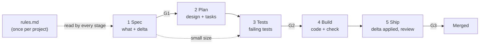

# Spec-Driven Development: The Simple Workflow

October 7, 2026

## The core idea

Write what you want in a structured form that you can check. Each stage makes a more concrete file from the previous one. The last stage is working code, with proof that it keeps the spec.

Four rules control the workflow:

1. **The spec is the source of truth.** The code is one way to make the spec true. If they disagree, change one of them on purpose.
2. **Each stage reads files, not chat memory.** Any person or agent can continue from any stage. The file `state.json` tells them where the change is.
3. **Tests come from the spec, before the code.** A person approves the tests: before the build in the full size, and at G3 in the small size.
4. **Only a person approves a gate.** Agents do the work. Agents never record an approval.



*5 stages · 3 human gates · 2 sizes (full and small). A problem found later returns the change to the stage that owns it.*

## Files

All workflow files are in one folder, `sdd/`, at the root of the repository.

```
sdd/
  rules.md                          ← project rules, changed only by review
  areas/                            ← current truth, one file per product area
    favorites.md
  changes/                          ← history, one folder per change, frozen after merge
    2026-09-14-favorites/
    2026-10-08-favorites-sorting/
      state.json  spec.md  plan.md  traceability.md  outcome.md
```

| File | Job | Who writes it | Changes after merge? |
| --- | --- | --- | --- |
| `rules.md` | Rules for every change | The team, by review | Yes, by review only |
| `areas/<area>.md` | What the system does now | Stage 5 only | Yes, at each Ship that touches the area |
| `changes/<date>-<slug>/` | How and why one change happened | Stages 1–5 | No, frozen |
| `state.json` | Owner, size, type, stage, and gates | Agents write the stage. Only a person's action adds an approval. | No |

The folder name is the start date and a slug. If a change folder (of any date) or a branch already uses the slug, the runner adds `-2`. Test names start with the slug, so it must be unique.

## Branches

Each change has one branch, and each branch has one change. The small size uses a branch too.

1. Stage 1 makes the branch `sdd/<start date>-<slug>` from the current branch (the base), before it writes a file. The branch name is the same as the change folder name.
2. The change files are only on the branch until the merge. The base branch shows only merged changes.
3. When a person approves a gate, the runner commits all work first, and the approval records that commit. The runner also commits after each passed exit check, so the tree is clean when it merges the base branch.
4. At the start of each stage, merge the base branch into the change branch, to find conflicts early. Do not rebase. A rebase removes the commits that the approvals name.
5. The person merges the change after G3, with the method from `rules.md`. The runner never pushes and never merges.
6. The rules use only the branch name, never a folder path. Thus a later move to one git worktree for each change needs no change to these rules.

The base is the branch where the person ran `/sdd`.

## Sizes

Each change has one of two sizes. The size decides which files and which gates the change needs.

| | Full | Small |
| --- | --- | --- |
| Use for | A feature, a new area, new data, an API change, or a change to more than one requirement | A bug, a refactor, a chore, docs, or a change to one requirement. A few files, no new data, no API change. |
| Delta | Any | Empty, or one MODIFIED item |
| Stages | 1 → 2 → 3 → 4 → 5 | 1 → 3 → 4 → 5 (no Plan) |
| Gates | G1, G2, G3 | G3 only. G3 also approves the spec and the tests. |
| Files | All five | `state.json`, a short `spec.md`, `traceability.md`, `outcome.md` |

**Change the size:**

- You can change small to full at any time before merge. Return to Stage 1 and use the small spec as the input.
- You can change full to small only before G1.
- If you are not sure, use full. It is easy to make a change smaller before G1. It is expensive to learn late that you needed a design.

**Type is a label, not a route.** `state.json` names one type. Each type has one rule:

| Type | Rule |
| --- | --- |
| feature | Always full. |
| change | Changes a requirement that is in the area spec. Show the old and the new text. |
| bug | The code breaks a requirement that is in the area spec or in the baseline. The delta is empty. If no requirement covers the case, the type is `change`. |
| refactor, chore | The delta is empty. The existing tests must pass. If a test assertion must change, the behavior changed: the type is `change`. A chore can change test code without a change to an assertion, for example for a new test tool. |
| docs | The delta is empty. No tests. |

**Spikes are not changes.** If you cannot write a spec yet, do a spike outside this workflow. Do not merge spike code. Use the result as an input to a new Stage 1.

**To stop a change,** delete its branch. Nothing merges.

## state.json

```json
{
  "owner": "Sam",
  "base": "main",
  "request": "Sort favorites by date",
  "size": "full",
  "type": "feature",
  "specVersion": 2,
  "stage": "build",
  "reviewRounds": 0,
  "gates": [
    { "gate": "G1", "result": "approved", "commit": "3f2a91c", "by": "Sam", "at": "2026-10-08" },
    { "gate": "G1", "result": "reopened", "reason": "Remove the 100-favorites limit", "by": "Sam", "at": "2026-10-09" },
    { "gate": "G1", "result": "approved", "commit": "8be04d7", "by": "Sam", "at": "2026-10-09" },
    { "gate": "G2", "result": "approved", "commit": "c19d5e2", "by": "Ana", "at": "2026-10-11" }
  ]
}
```

- `owner` is `git config user.name`.
- `stage` is one of: `spec`, `plan`, `tests`, `build`, `ship`, `done`. The value `done` means that G3 is approved and the change is ready to merge.
- `specVersion` starts at 1. Each spec change after G1 increases it.
- When a person approves a gate, the tool commits all work, adds the approval with that commit, and then commits `state.json`. A gate is approved only if both conditions are true:
  - Its last entry is `approved`.
  - No file that the gate covers changed after that commit. See *Gates* for the files that each gate covers.
- Agents can add a `reopened` entry. Only a person's action, for example a dialog in the tool, adds an `approved` entry.
- Never delete an entry. Edits to `state.json` never reopen a gate.

## Return rule

If a stage finds a problem, return the change to the stage that owns the problem.

| Problem | Return to |
| --- | --- |
| Wrong or missing behavior, a stale delta | 1 Spec |
| Wrong technical approach, a missing task | 2 Plan |
| A wrong or weak approved test | 3 Tests |
| A code defect, a review comment on the code | 4 Build |

In the small size, a Plan problem means that the change is not small. Change the size to full.

When you return a change:

1. Set `stage` to the stage that owns the problem.
2. If the spec changes, increase `specVersion` and add a line to the change log in `spec.md`.
3. Add a `reopened` entry for each approved gate at the end of that stage or after it. For example, a return to Stage 3 reopens G2 and G3.
4. If Ship already edited the area specs, copy them again from the base branch.
5. Continue from that stage. In each later stage, keep the work that is still correct, and change only what the problem affects. Each exit condition and each gate must pass again.

Never change only the code. If the code changes and the spec does not, the spec is false.

## Project setup: rules.md

Write one rules file for each project. Change it only by review, and increase its version each time. A change can find a problem in the rules ("the agent keeps doing X"). If so, change the rules in a separate review, not in that change.

In an existing project, write the rules from what the code already does. Do not write rules that the code does not obey.

If the project has no `sdd/rules.md`, the runner starts with a setup stage: the agent drafts the rules, and the person approves them. The runner runs the Full tier only after the approval. The approval makes one commit, `sdd(<slug>): rules approved`. If the person stops before the approval, the next `/sdd` asks again.

```markdown
# Project Rules  (version 1.0)

## Principles
### 1. <Name>
Rule: <one clear sentence that a person or a tool can check>
Why: <reason>

### 2. Tests first (always)
Rule: Each acceptance scenario has a test. A person approves it before the build (full size) or at G3 (small size).
Why: Tests prove the spec, not the code.

## Quality defaults (each change, unless its spec says otherwise)
- Performance: <e.g. main screens open in < X ms>
- Security: <e.g. no secrets in code, all input validated>
- Privacy: <e.g. collect only the data a feature needs>
- Accessibility: <target level, if the project has a UI>
- Reliability: <e.g. show errors, never hide them>

## Commands
- Full tier: npm test
- JUnit reports: reports/*.xml
- Fast tier: npx vitest run --changed
- Test files: **/*.test.ts, e2e/**/*.e2e.ts
- Mutation: npx stryker run | none
- Inner TDD: optional
- Merge method: pull request on GitHub

## Flaky tests
- Do the test again once. If it is flaky, quarantine it with an owner, an issue, and a deadline.
- Never quarantine an acceptance test without approval from the G2 approver.

## Gate approvers
- G1 (spec): <name or role>
- G2 (plan and tests): <name or role>
- G3 (ship): <name or role>
```

**Done when:** a person or a tool can check each rule, the list is short, and the commands and approvers are written. "Write clean code" is not a rule. "All server data goes through one data layer" is a rule.

## Stage 1 — Spec (the "what")

The spec tells what the user needs and why. It contains no technology.

**Input:** the request, `rules.md`, and the area specs that the change touches.

**Output:** `spec.md` and `state.json`.

**Steps:**

1. Write the request in one or two sentences.
2. Read the area spec of each area that the change touches.
3. Select the type and the size, and call `classify_change`. If the request is too big for one spec, split it into several changes.
4. The runner makes the branch and the change folder, and writes `state.json`.
5. If the area spec does not describe the behavior that the change touches, write a **baseline** (see *Existing code*).
6. Write the goal: the problem, who has it, and why it is important.
7. Split the change into user stories. Give each story a priority (P1 = necessary).
8. For each story, write acceptance scenarios as **Given / When / Then**. Each "Then" must be visible or measurable.
9. Write the **delta**. Use `NEW-R1`, `NEW-R2` for new requirements and `NEW-Q1` for new quality requirements. Stage 5 gives them final IDs. For a new area, select its ID prefix, for example `FAV`.
10. Use the quality checklist. Give each item a measurable target, "rules default", or "N/A + reason".
11. Write the edge cases and the items that are out of scope.
12. Write each unclear item as an open question. Do not guess.
13. Ask the owner the open questions, one at a time. Give 2–4 options and a recommendation.
14. Write each answer into the requirement that it affects. Record it in *Decisions*.
15. Check the size again. If the change grew, split it. If it became small, you can change to small now.

**Template:**

```markdown
# Spec: Favorites sorting
Areas: favorites (sdd/areas/favorites.md)

## Goal
Users with many favorites cannot find recent ones. They need the newest first and a sort by date.

## User stories
### US1 — Sort by date (P1)
As a user, I want to sort my favorites by date, so that I find recent ones fast.
- [US1-S1] Given 3 favorites added on different days, When I select "Sort by date", Then the list shows them newest first

### US2 — Newest first by default (P1)
- [US2-S1] Given 3 favorites, When I open the list, Then the newest favorite is at the top

## Delta
### sdd/areas/favorites.md
- ADDED    NEW-R1: Users can sort favorites by date
- ADDED    NEW-Q1: Sort of 500 favorites takes < 100 ms
- MODIFIED FAV-R-002: List shows newest first
    (was: List shows in the order added)
- REMOVED  FAV-R-003: Max 100 favorites
    (why: the limit is not necessary now)

## Quality checklist
- Performance: NEW-Q1
- Security: N/A, no new data or access
- Privacy: N/A, no new data
- Reliability: rules default
- Accessibility: rules default
- Compatibility: N/A, each favorite already has a date

## Edge cases
- Two favorites with the same date: sort by name

## Out of scope
- Sort by name (issue #45)

## Decisions
- 2026-10-08 Q: Sort by name too? A: No, out of scope. Changed: Out of scope

## Change log
- v1 → v2 (2026-10-09): Removed the 100-favorites limit. Changed: REMOVED FAV-R-003. Reopened: G1
```

**Done when:**

- No open questions remain.
- Each requirement is testable and contains no technology words.
- The delta lists each ADDED, MODIFIED, and REMOVED item, quality items included.
- Each quality item has a target, "rules default", or "N/A + reason".

**Gate G1:** A person approves the spec. Question: *Is this the right thing to build?*

## Stage 2 — Plan (the "how", full size only)

The plan turns the spec into a technical approach and a task list. All technology choices are in the plan, not in the spec.

**Input:** the approved spec, `rules.md`, and the code that the change touches.

**Output:** `plan.md`.

**Steps:**

1. Write the technical context: stack, platforms, and constraints.
2. Read the existing code. List what to reuse, so that nobody builds it again.
3. Check each new dependency: is it maintained, is the license correct, and does it have known security problems?
4. Write the data model, the contracts (API shapes, events, UI test IDs), and the test data (named fixtures).
5. Write the security and privacy check, and the compatibility and migration plan.
6. Record each decision: what, why, and what you did not select.
7. Write the tasks. Use the phases that you need, in this order: setup, foundation, one phase for each story (by priority), polish.
8. Mark each test task with `(test)`. Stage 3 does the test tasks before the build. Stage 4 does the other tasks.
9. Give each task the requirement or scenario IDs that it serves and its files. Mark tasks that can run in parallel with `[P]`.
10. Do the **consistency check** (below). If it fails, correct the plan, or return to Stage 1.

**Consistency check:**

- Each requirement, quality requirement, and REMOVED item has a part of the plan and a task.
- Each scenario has a test task.
- The plan obeys each rule, or the exception is written with a reason.
- No two parallel tasks touch the same file.

**Template:**

```markdown
# Plan: Favorites sorting
Spec: version 2

## Technical context
Stack, platforms, storage, test tools, constraints

## Reuse and dependencies
- Reuse: <module> for <purpose>
- New dependency: none

## Data model
Favorite: id, title, addedAt (existing field, set for each favorite since 2026-09-14-favorites)

## Contracts
- GET /favorites?sort=date → [{ id, title, addedAt }]   (default sort: newest first)
- UI test IDs: fav-sort-date (US1-S1), fav-list (US1-S1, US2-S1)

## Security and privacy
- Data touched: favorites of the signed-in user only   Threats: none new

## Compatibility and migration
- None: no new fields, and the API change is additive

## Test data
- Fixture three-favorites: 3 favorites on 3 days (US1-S1, US2-S1)

## Decisions
- Sort on the server | Why: lists can be long | Not selected: sort in the client

## Rules exceptions
- none

## Tasks
### Phase 1 — Foundation
- [ ] T001 (test) [GET /favorites] Contract test in contracts/favorites.test.ts
- [ ] T002 (test) [FAV-R-003] Delete the old test e2e/favorites-us1-s4-limit
- [ ] T003 [NEW-R1] Sort parameter in api/favorites.ts
- [ ] T004 [FAV-R-003] Remove the 100-favorites limit in api/favorites.ts

### Phase 2 — US1 Sort by date (P1)
- [ ] T005 (test) [P] [US1-S1] E2E test in e2e/favorites-sorting-us1-s1.e2e.ts
- [ ] T006 (test) [P] [NEW-Q1] Performance test in logic/sort.perf.test.ts
- [ ] T007 [US1-S1] Sort control in FavoritesList.tsx
Checkpoint: US1 works alone and its tests pass

### Phase 3 — US2 Newest first (P1)
- [ ] T008 (test) [US2-S1] E2E test in e2e/favorites-sorting-us2-s1.e2e.ts; delete e2e/favorites-us1-s2-order-added
- [ ] T009 [FAV-R-002] Default sort newest first in api/favorites.ts
Checkpoint: US2 works alone and its tests pass
```

There is no gate here. The plan goes to G2 together with the tests, because the tests use the contracts from the plan.

## Stage 3 — Tests (proof first)

The acceptance scenarios become tests before the feature code exists.

**Input:** the spec scenarios, and the contracts, test data, and test tasks from the plan.

**Output:** the test files and `traceability.md`.

**Steps:**

1. Existing code only: write **characterization tests** for the baseline items that the change must not change (see *Existing code*). They must pass on the current code.
2. For each scenario, write one test at the lowest level that proves it (see *Test levels*).
3. Start the name of each scenario test with the change slug and the scenario ID, for example `favorites-sorting-us1-s1`. Then the names stay unique across changes.
4. Write the tests for the quality requirements and a contract test for each API or event in the plan.
5. If a requirement is MODIFIED, change its old tests to the new behavior, or delete them if a new test replaces them. If a requirement is REMOVED, delete its old tests. Write each of these in `traceability.md`.
6. Run the tests. New and changed tests must **fail** for the correct reason: the feature is missing, the test is not broken.
7. Fill `traceability.md`. Leave *Evidence* and *Verdict* empty. Tick the test tasks in `plan.md`.

**Small size:**

- Bug or change: write one failing test for the scenario.
- Refactor or chore: make sure that tests cover the requirements that must not change. If the coverage is weak, add tests first. They must pass on the old code.
- Docs: no tests.
- Write `traceability.md` with one row for each test.

**Template (after Stage 3):**

```markdown
# Traceability: Favorites sorting
| ID | Scenario | Level | Test | Status | Evidence | Verdict |
|---|---|---|---|---|---|---|
| NEW-R1 | US1-S1 | E2E | e2e/favorites-sorting-us1-s1 | failing (expected) | | |
| FAV-R-002 | US2-S1 | E2E | e2e/favorites-sorting-us2-s1 (replaces e2e/favorites-us1-s2-order-added) | failing (expected) | | |
| NEW-Q1 | Performance | Unit | logic/sort.perf.test | failing (expected) | | |
| GET /favorites | Contract | Contract | contracts/favorites.test | failing (expected) | | |
| FAV-R-003 | REMOVED | — | e2e/favorites-us1-s4-limit deleted | — | | |
```

The Test column holds the path and the tag of the test. The runner matches the last path part, for example `favorites-sorting-us1-s1`, against the names in the JUnit reports. A docs change has no `traceability.md`.

**Gate G2:** A person approves the plan and the tests together. Questions: *Is this the right way to build it, safely and compatibly? Do these tests truly express the spec?*

An **approved test** is a test that `traceability.md` lists. After G2, a change to an approved test returns the change to Stage 3 and needs G2 again. In the small size, G3 approves the test changes.

## Stage 4 — Build (code until the check passes)

Write code until the tests pass, one story at a time. Then check the code against the spec.

**Input:** `spec.md`, `plan.md`, `traceability.md`, and the failing tests.

**Output:** the code, the ticked tasks, and `traceability.md` with results.

**Steps:**

1. Do the foundation tasks first, migrations and fixtures included.
2. For each story, in priority order, do its tasks until its tests pass. Run the fast tier at the story checkpoint.
3. Tick each task when it is done. Commit in small steps.
4. Use a new agent session for each story, to keep the context small.
5. When all stories are done, run the full tier. Fill *Status*, *Evidence* (the file that does the work), and *Verdict* (the runner sets met or missing) in each row. A test that passes while the requirement is only partly met is a weak test: use `request_return` with the stage tests.
6. If `rules.md` names a mutation tool, run it on the changed code. If the score is below the minimum, find the weak tests:
   - If a weak test is not in `traceability.md`, make it stronger now.
   - If a weak test is an approved test, return to Stage 3.
7. Add a row with the verdict **extra** for each piece of code that the spec did not ask for. Remove the code, or return to Stage 1 to add it to the spec.
8. Check the rules again on the final code.
9. If a row is not met because of a code gap, add a task and continue at step 2. For any other problem, use the *Return rule*.

**Small size:** there are no tasks. Make the smallest change that makes the tests pass. Then do steps 5–9.

**Rules:**

- Do the tasks in their order. Do not add things that the spec did not ask for.
- **Never change an approved test to make it pass.** If a test is wrong, return to Stage 3. If the spec is wrong, return to Stage 1.
- Strict red → green → refactor for each task is optional for agents. The acceptance tests from Stage 3 are always necessary.

**Footer of `traceability.md` (after Stage 4):**

```markdown
Full tier: passing   Mutation: 87% (minimum 80%) | none configured
Rules check: all pass
Notes for review: <anything surprising, anything hard>
```

**Done when:** all tasks are ticked, each row is met with evidence, no **extra** rows remain, the full tier passes, and the mutation score is at the minimum or higher (if configured). This stage has no human gate. The check is its exit condition.

## Stage 5 — Ship (apply, review, approve, merge)

Write the final result first, then review it, then merge it. The person at G3 approves the final diff exactly as it will merge.

**Input:** the change folder, the area specs, and the diff.

**Output:** the updated area specs, `outcome.md`, and the merged change.

**Steps:**

1. Merge the base branch into the change branch.
2. Check that each MODIFIED and REMOVED item, and each requirement that a bug names, still has the same text in the area spec. If not, another change touched the same requirement first: return to Stage 1.
3. Copy each area spec that the change touches from the base branch, so that you start from the current truth. This removes the edits of an earlier Ship.
4. Give each `NEW-*` and `BASE-*` item the next ID from the *Next IDs* line of its area spec, for example `NEW-R1` → `FAV-R-005`. Then increase the line. Never use an ID again, also after it is REMOVED. Write the map in `outcome.md`.
5. Apply the delta to each area spec:
   - Feature or change: add, replace, or delete the requirements. Add the test links.
   - Bug: add only the test link.
   - Refactor, chore, or docs: add only the links for new tests, if there are new tests.
   - Brownfield: add the baseline items and the *Coverage* line (see *Existing code*).
   - If you edited the area spec, add one history line.
6. Run the full tier on the change branch.
7. Write `outcome.md`: what was delivered, the evidence, what changed after approval, the ID map, and what is left open as issues.
8. Do the review. Use an AI reviewer in a new session, a person, or both. Write the notes in `outcome.md`. The review checks:
   - The code fits the existing structure and does not build again what exists.
   - The code has no over-engineering: no code for cases that the spec does not need.
   - The tests would fail if the code broke.
   - The names, the error handling, and the docs are correct.
   - The area spec diff matches the delta exactly.
9. If the review finds a problem, use the *Return rule*.
10. **Gate G3:** a person approves the final diff. The tool sets `stage` to `done` in the same edit.
11. The person merges with the method from `rules.md`. The runner tells the person when the branch is ready.

**Done when:** the change is merged and CI passes on the base branch. If CI fails on the base branch after the merge, start a new change of type `bug`. The merged change folder is frozen.

**Template (`outcome.md`):**

```markdown
# Outcome: Favorites sorting
PR: <link | none>   Spec version: 2

## Delivered
- US1 Sort by date ✓   US2 Newest first ✓

## Evidence
- 4 of 4 rows met, 1 REMOVED row done, full tier passing (see traceability.md)

## Changed after approval
- Spec v2: removed the 100-favorites limit after G1

## ID map
- NEW-R1 → FAV-R-005   NEW-Q1 → FAV-Q-002

## Review
| # | File | Problem | Action | Done |
|---|---|---|---|---|
| 1 | api/favorites.ts | Copies an existing helper | Use the helper | ✓ |

## Left open
- Issue #45: sort by name
```

**Template (area spec after Ship):**

```markdown
# Area spec: Favorites
Prefix: FAV   Next IDs: FAV-R-006, FAV-Q-003

## Current behavior
- FAV-R-001: Users can add and remove a favorite.  (since 2026-09-14-favorites)
- FAV-R-002: List shows newest first.  (since 2026-10-08-favorites-sorting; was: order added)
- FAV-R-004: Favorites sync across devices.  (since 2026-09-14-favorites)
- FAV-R-005: Users can sort favorites by date.  (since 2026-10-08-favorites-sorting)

## Quality requirements
- FAV-Q-001: List opens in < 500 ms with 100 items.  (since 2026-09-14-favorites)
- FAV-Q-002: Sort of 500 favorites takes < 100 ms.  (since 2026-10-08-favorites-sorting)

## Tests
- FAV-R-001 → e2e/favorites-us1-s1
- FAV-R-002 → e2e/favorites-sorting-us2-s1
- FAV-R-004 → e2e/favorites-us2-s1
- FAV-R-005 → e2e/favorites-sorting-us1-s1
- FAV-Q-001 → logic/list.perf.test
- FAV-Q-002 → logic/sort.perf.test

## History
- 2026-10-08-favorites-sorting: ADDED FAV-R-005, FAV-Q-002; MODIFIED FAV-R-002; REMOVED FAV-R-003
- 2026-09-14-favorites: created the area (FAV-R-001 to FAV-R-004, FAV-Q-001)
```

**Rule of thumb:** to know *what* the system does, read the area spec. To know *why*, follow its history to the change folder.

## The small size

The small size uses the same stages without Plan, with shorter files and one gate. It keeps the hard rules: spec first, test first, and a person approves before merge.

1. **Spec:** read the area spec. Write the short spec below.
2. **Tests:** write the failing test, or make sure that tests cover the behavior that must not change (see Stage 3). Write `traceability.md`.
3. **Build:** make the smallest change that makes the tests pass. For a refactor or chore, the existing test assertions must not change. Fill the results in `traceability.md`.
4. **Ship:** do Stage 5. G3 approves the spec, the tests, and the code together.

If the change touches data, an API, or more than one requirement, change the size to full.

```markdown
# Spec: <title>
Area: <area>   Requirement: <ID of the broken or changed requirement>
Current: <what happens now>
Expected: <what must happen>
Must not change: <IDs>

## User stories
### US1 — <title> (P1)
- [US1-S1] Given …, When …, Then …

## Delta
none
```

For a change to one requirement, write one MODIFIED item under `## Delta`, with its area heading and its `(was: …)` line. For a refactor or chore, write `Current: <code state>`, `Expected: no behavior change`, and the `Must not change` list. For docs, write only the reason, one story, and "none" under `## Delta`.

## Existing code (brownfield)

The workflow stays the same. Only one rule is new: **write a baseline before a delta.** A delta cannot say MODIFIED if nothing describes the old behavior.

Do not write specs for the full system first. Write specs only for the behavior that a change touches.

1. If the area spec does not describe the behavior that the change touches, read the code.
2. In `spec.md`, write a *Baseline* section above the delta. It lists the current behavior, marked "from code".
3. For each baseline item that the change touches, ask the owner: *Is this behavior intended?*
   - If yes, keep the item. A change to it is a MODIFIED item in the delta.
   - If no, write the intended behavior as the item, and add `Defect: <what the code does>`. The fix needs no delta item, only a failing test. If the change does only this fix, its type is `bug`.
4. In Stage 3, write characterization tests for the intended items that the change must not change. They must pass on the current code. Do not write a characterization test for a defect item. Write a failing test for it.
5. In Stage 5, add the baseline items to the area spec with their final IDs, and then apply the delta. Add a *Coverage* line that names the parts of the area that have no spec yet.

A baseline requirement shows `(since <folder>, baseline)` in the area spec. A `Coverage:` line in the Baseline section becomes the Coverage section of the area spec.

```markdown
## Baseline (from code)
- BASE-R1: Cart total includes tax.
    Intended? yes → characterization test
- BASE-R2: Payment fails if the card is expired; error shows "Card expired".
    Defect: the code shows "Payment failed". Intended? no → failing test
## Delta
- ADDED    NEW-R1: Saved cards are offered first
```

Areas that nobody touches stay "the code is the truth". That is acceptable.

## Test levels

Select the lowest level that proves the scenario. All three levels come from the spec.

| Scenario | Level |
| --- | --- |
| Main path of each P1 story | E2E (at least one for each P1 story) |
| Failure paths that the user sees (empty, offline, error) | E2E (a few) |
| Data layer, API handling, state changes | Integration |
| Business rules, calculations, many variations of one rule | Unit |

**E2E rules:**

- One E2E scenario = one test, named with the change slug and the scenario ID.
- Use test IDs, not visible text or layout.
- Each test starts from a clean state and does not depend on other tests.
- Control the data: seeded test accounts or a mocked backend, never random real data.
- Keep the suite small. A slow or flaky suite stops being run.

## Gates

| Gate | After | Question | Covers | Small size |
| --- | --- | --- | --- | --- |
| G1 | Spec | Is this the right thing to build? | `spec.md` | Not used |
| G2 | Plan + Tests | Is this the right way to build it? Do the tests truly express the spec? | `spec.md` and the approved tests (the tests that `traceability.md` lists) | Not used |
| G3 | Ship | Is the final diff, area spec diff included, correct and good code to keep? | The full diff of the branch, except `state.json` | Also approves the spec and the tests |

A gate opens again if a file that it covers changes after its approval. Thus a spec change opens all three gates again. G2 does not cover `plan.md` and `traceability.md`, because Build ticks the tasks and fills the results. A plan change after G2 uses the *Return rule*.

At a gate, **Change** starts a new session of the stage with the feedback of the person.

If files change while a gate is open, the runner restores the protected files, commits the other changes, and shows the gate again. The approval records the commit that the person saw. If the branch changed, the runner stops: switch back to the change branch and run `/sdd` again.

`/sdd` with no request continues the change of the current branch. It reads `state.json` from the last commit, restores the protected files, and merges the base branch. If the review is done, it goes directly to G3.

## Limits

- The write guard sees only the write and edit tools. The Tests and Build stages also have bash. After each session, the runner restores the protected files that bash changed.
- If the app stops during a session, the runner trusts the git history on the next `/sdd`. A stage with bash can change that history.
- Read the branch diff before you merge.

## Quick reference

| # | Stage | Reads | Writes | Exit | Who |
| --- | --- | --- | --- | --- | --- |
| — | Rules (once) | Team standards, existing code | `rules.md` | Team review | Team |
| 1 | Spec | Request, rules, area specs | `spec.md`, `state.json` | **G1** (full) | Owner + agent |
| 2 | Plan (full only) | Spec, rules, code | `plan.md` | Consistency check passes | Agent |
| 3 | Tests | Spec, plan | Tests, `traceability.md` | **G2** (full) | Agent |
| 4 | Build | Spec, plan, traceability, tests | Code, ticked tasks, results | Each row met, full tier passes | Agent |
| 5 | Ship | Delta, area specs, diff | Area specs, `outcome.md` | **G3**, then merge | Agent + reviewer |
| ↺ | Return | The problem | Earlier stage, `reopened` entries, area specs copied from the base branch | The gates again | Anyone; a person approves |
